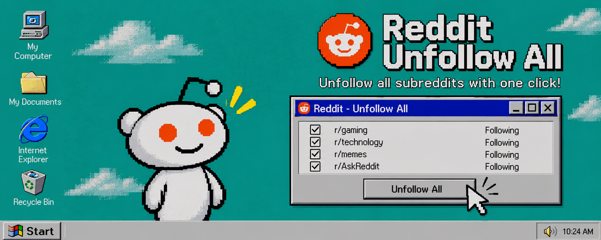

 <h1>Reddit Unfollow All</h1>

  
  

**Bulk unfollow subreddits, and keep the ones you love.**

A Chrome extension for the spring cleaning you do on Reddit every now and then.
Pick the subreddits to keep, press start, and it leaves all the others for you.

 

## Screenshot

## What you can do

| Area | What you can do |
|---|---|
| **Whitelist** | Tick the subreddits you want to stay subscribed to, for example r/Turkey or r/programming. Everything else is unfollowed. |
| **Search and filter** | Find a subreddit in the list before you start. Keep all or keep none with one click. |
| **Speed** | Press the badge next to Start to move through the speeds from 1x to 4x, so you can go gently if Reddit pushes back. |
| **Cancel** | Stop in the middle. Subreddits already left stay left. |
| **Undo** | Changed your mind? Press the ↶ button to rejoin the subreddits you left. It works until you reload or leave the page. |
| **Both Reddit designs** | Works on the current Reddit and on `old.reddit.com`. |
| **Two languages** | A one-click English and Turkish switch. |

## Getting started

The extension is not on the Chrome Web Store yet, so you load it by hand:

1. **Download** `reddit-unfollow-all-<version>.zip` from the [Releases page](../../releases) and extract it anywhere. (Or clone this repository.)
2. **Open** `chrome://extensions/` in Chrome and switch on **Developer mode** in the top right.
3. **Load it.** Press **Load unpacked** and choose the extracted folder.
4. **Use it.** Go to your subscriptions page (`reddit.com/subreddits` or your communities page). Press **Unfollow All** next to the **Manage communities** heading to open the panel.

You can also open or close the panel with the extension's toolbar icon or `Alt+Shift+U`. From any other page, these open your subscriptions page in a new tab with the panel ready.

Then:

1. **Review the list.** Press the **Kept** counter to see all your subscriptions.
2. **Pick what to keep.** Tick the subreddits that should stay. Your choices are saved on your device for next time.
3. **Start.** Press **Start**. It skips the ones you ticked.

> [!IMPORTANT]
> Unfollowing is done through Reddit's own buttons. You can only undo it from the panel until you reload or leave the page, so check your whitelist before you press Start.

## Requirements

- Google Chrome, or another Chromium-based browser that can load unpacked extensions.
- A Reddit account that is signed in.

## Questions

**Does it send my data anywhere?**
No. Everything runs in your browser. See [PRIVACY.md](PRIVACY.md).

**The panel doesn't appear.**
Press **Unfollow All** on the page, the toolbar icon or `Alt+Shift+U`. If you reached your communities page by clicking through Reddit's menus, reload the page first. If the button can't find the heading, it appears in the bottom right corner instead.

**`Alt+Shift+U` doesn't work.**
Chrome only assigns the shortcut on a fresh install, and not if another extension already uses it. Set it at `chrome://extensions/shortcuts`.

**The panel warns that Reddit's page may have changed.**
The extension may not work until it is updated. Press **Report** to open a pre-filled issue on GitHub. You can read it before you send it, and it doesn't include your username or subreddits.

**It stops or skips some subreddits.**
Pick a slower speed and start again. Reddit can limit how fast you click.

## Reporting problems

If something goes wrong, click the GitHub button in the panel's top right corner to open a pre-filled form, or open an [issue](../../issues/new/choose) yourself and say which Reddit design you use (new or old) and what the panel's log says.

## Contributing

See [CONTRIBUTING.md](CONTRIBUTING.md). To report a security problem, see [SECURITY.md](SECURITY.md).

## Building from source

There is nothing to build. The extension is plain JavaScript and CSS: load the repository folder with **Load unpacked** as described above.

## License

MIT. See [LICENSE](LICENSE) for details.
