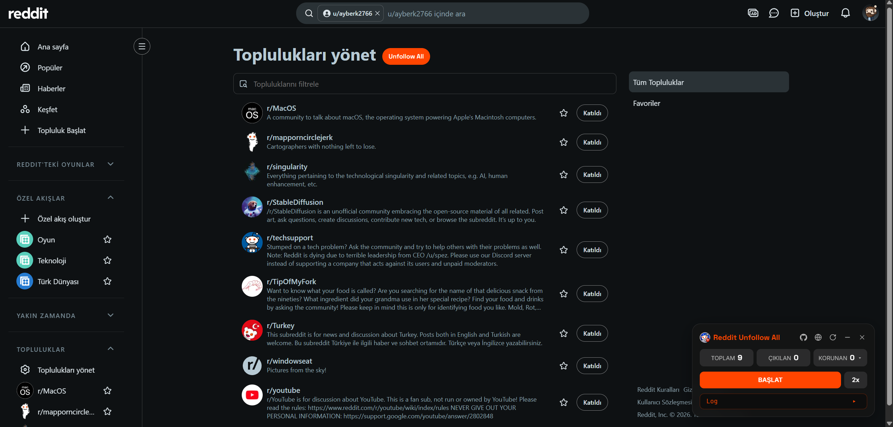
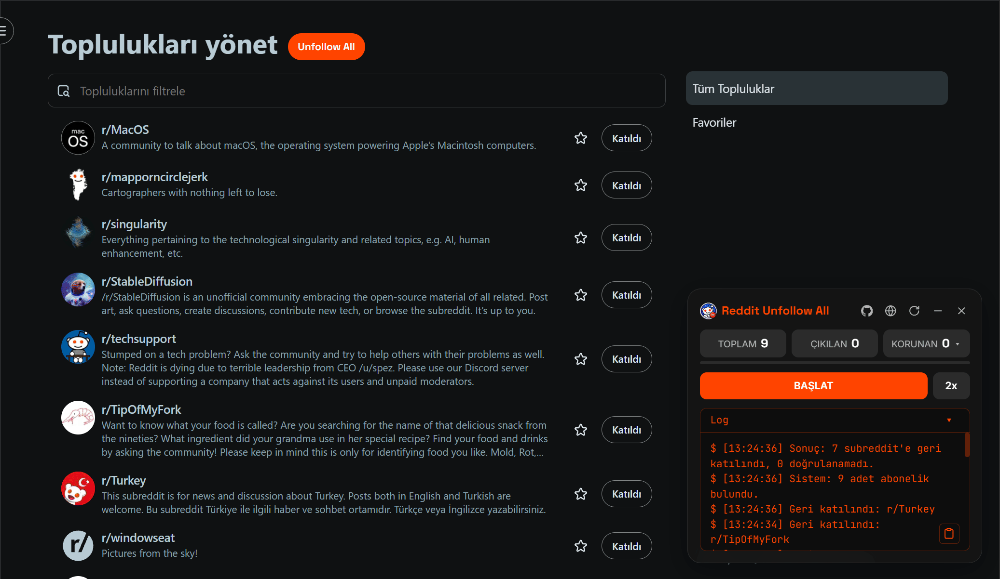

# Reddit Unfollow All

**Subredditlerden toplu çıkın, sevdiklerinizi tutun.**

Reddit'te ara sıra yaptığınız temizlik için bir Chrome ve Firefox eklentisi.
Tutmak istediğiniz subredditleri seçin, başlatın, gerisini eklenti sizin yerinize yapsın.

<a href="README.md">English</a> | Türkçe

 

## Ekran görüntüleri

## Neler yapabilirsiniz

| Alan | Ne yapabilirsiniz |
|---|---|
| **Beyaz liste** | Kalmasını istediğiniz subredditleri işaretleyin, örneğin r/Turkey veya r/programming. Geri kalan her şeden çıkılır. |
| **Arama ve filtre** | Başlamadan önce listede subreddit arayın. Tek tıkla hepsini ya da hiçbirini tutun. |
| **Ayarlar** | Panelde dişli düğmeye basıp dili, 1x ile 4x arasındaki hızı ve %200'e kadar panel boyutunu seçin. Reddit geri iterse daha yavaş gidin. Panel büyük ekranlarda daha büyük açılır ve boyutunuzu hatırlar. |
| **İptal** | İşlemi yarıda bırakın. Çıkılmış subredditler çıkılmış kalır. |
| **Geri al** | Fikriniz mi değişti? ↶ düğmesine basıp çıktığınız subredditlere yeniden katılın. Sayfayı yenileyene ya da ayrılana kadar çalışır. |
| **İki Reddit tasarımı** | Güncel Reddit'te ve `old.reddit.com` üzerinde çalışır. |
| **İki dil** | İngilizce ve Türkçe. |

## Kurulum

**Chrome:** Eklentiyi [Chrome Web Store](https://chromewebstore.google.com/detail/reddit-unfollow-all/lecbgbpldemagjcdjdbifciecnhhgfhl) üzerinden kurun.

**Firefox:** Eklentiyi elle yükleyin:

1. `reddit-unfollow-all-<sürüm>.zip` dosyasını [Releases sayfasından](../../releases) indirin ve istediğiniz yere çıkarın. (Ya da bu depoyu klonlayın.)
2. `about:debugging#/runtime/this-firefox` adresini açın, **Load Temporary Add-on** düğmesine basın ve çıkardığınız klasördeki `manifest.json` dosyasını seçin. Firefox yeniden başlatıldığında geçici eklentiyi kaldırır.

**Kullanım:** Abonelik sayfanıza gidin (`reddit.com/subreddits` ya da topluluklar sayfanız). Panel kendiliğinden açılır. Çıkmak için **Manage communities** başlığının yanındaki **Unfollow All** düğmesine basın: eklenti önce kaç subreddetten çıkacağını ve kaçını tutacağını gösterir, siz onaylayınca başlar.

Paneli açmak ya da kapatmak için araç çubuğu simgesini ya da `Alt+Shift+U` kısayolunu da kullanabilirsiniz. Başka bir sayfadayken bunlar abonelik sayfanızı panel hazır olarak yeni sekmede açar.

Sonra:

1. **Listeyi inceleyin.** Tüm aboneliklerinizi görmek için **Kept** sayacına basın.
2. **Neyi tutacağınızı seçin.** Kalmasını istediklerinizi işaretleyin. Seçimleriniz bir dahaki sefere için cihazınızda saklanır.
3. **Başlatın.** **Start** düğmesine basın. İşaretlediklerinizi atlar.

> [!IMPORTANT]
> Çıkma işlemi Reddit'in kendi düğmeleriyle yapılır. Sayfayı yenileyene ya da ayrılana kadar panelden geri alabilirsiniz, bu yüzden Start'a basmadan önce beyaz listenizi kontrol edin.

## Gereksinimler

- Google Chrome ya da yüklenmemiş eklentileri yükleyebilen başka bir Chromium tabanlı tarayıcı.
- Firefox 142 veya üzeri.
- Giriş yapılmış bir Reddit hesabı.

## Sorular

**Verilerimi bir yere gönderiyor mu?**
Hayır. Her şey tarayıcınızda çalışır. Ayrıntılar için [PRIVACY.tr.md](PRIVACY.tr.md) dosyasına bakın.

**Panel görünmüyor.**
Abonelik sayfalarında panel kendiliğinden açılır. Kapattıysanız sayfadaki **Unfollow All** düğmesine, araç çubuğu simgesine ya da `Alt+Shift+U` kısayoluna basın. Düğme başlığı bulamazsa bunun yerine sağ alt köşede görünür.

**`Alt+Shift+U` çalışmıyor.**
Chrome kısayolu yalnızca temiz kurulumda atar ve başka bir eklenti aynı kısayolu kullanıyorsa atamaz. `chrome://extensions/shortcuts` adresinden ayarlayın. Firefox'ta `about:addons` adresini açın, dişli düğmesine basıp **Manage Extension Shortcuts** seçeneğini seçin.

**Panel Reddit'in sayfasının değişmiş olabileceği uyarısı veriyor.**
Eklenti güncellenene kadar çalışmayabilir. **Report** düğmesine basarak GitHub'da önceden doldurulmuş bir sorun açın. Göndermeden önce okuyabilirsiniz, kullanıcı adınızı ya da subredditlerinizi içermez.

**Bazı subredditleri atlıyor ya da durduruyor.**
Daha yavaş bir hız seçip yeniden başlatın. Reddit tıklama hızınızı sınırlayabilir.

## Sorun bildirme

Bir sorun olursa panelin ayarlarını dişli düğmesiyle açın ve **Report** ile önceden doldurulmuş formu açın. Ya da kendiniz bir [sorun](../../issues/new/choose) açın; hangi Reddit tasarımını kullandığınızı (yeni ya da eski) ve panelin günlüğünün ne dediğini yazın.

## Katkıda bulunma

[CONTRIBUTING.md](CONTRIBUTING.md) dosyasına bakın. Bir güvenlik sorununu bildirmek için [SECURITY.md](SECURITY.md) dosyasına bakın.

## Kaynaktan derleme

Derlenecek bir şey yok. Eklenti düz JavaScript ve CSS'ten oluşuyor: depo klasörünü yukarıda anlatıldığı gibi **Load unpacked** ile yükleyin.

## Lisans

MIT. Ayrıntılar için [LICENSE](LICENSE) dosyasına bakın.
